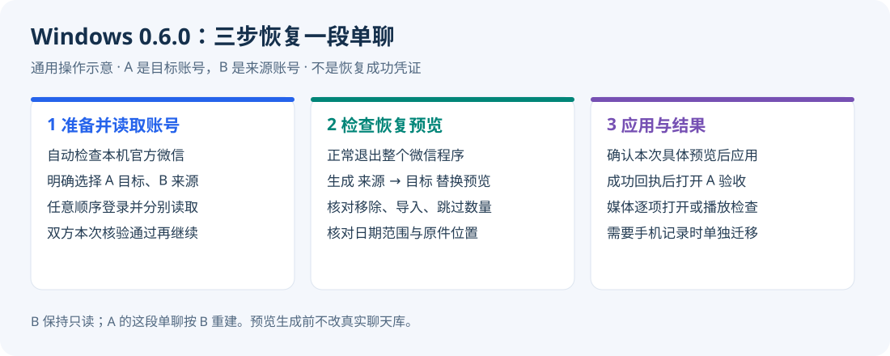
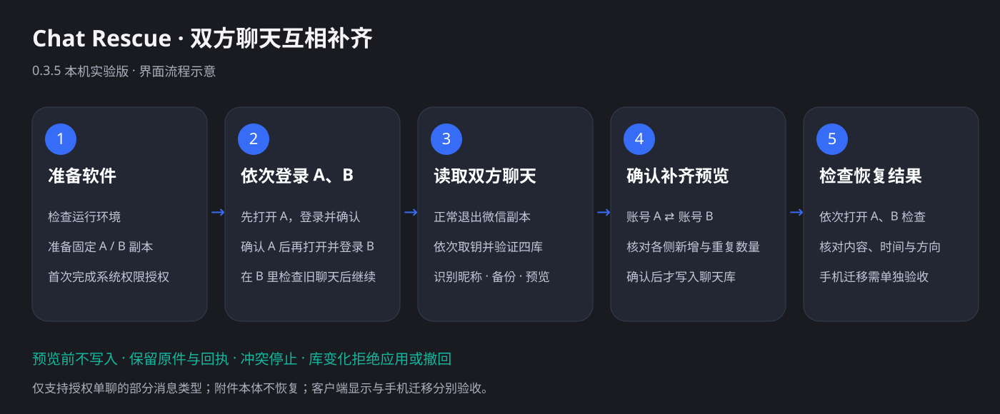

# chat_rescue：微信聊天记录误删恢复工具（Mac / Windows 离线实验支持）

**帮助你找回与重要的人的微信聊天记录。** 如果你误删了某段单聊，而对方还保留着这段记录，可以在双方授权后，用对方的记录生成自己视角的恢复候选，核对发送/接收方向、时间与数量，备份后再确认应用。

## 这个项目是做什么的

Chat Rescue 面向这样的情况：**你误删了和某个人的一段微信单聊，而对方还保留着双方的记录。** 在双方授权后，工具读取保留方的真实记录，转换为你自己的发送/接收视角，生成可核对的恢复候选，保存原件，最后由你确认应用。

例如：A 误删了与 B 的聊天，B 的手机或电脑上仍有记录。**A 选为“目标账号 · 要恢复到这里”，B 选为“来源账号 · 提供聊天记录”。** 记录只在手机时，先通过微信自己的“导入聊天记录”功能，把手机 B 的记录导入电脑 B，再用本工具读取。

当前 Windows 桌面版执行 **B → A 单聊替换**：A 中与 B 的这段会话按 B 的记录重建，预览会列出 A 将移除、B 将导入和暂不导入的数量。**A 独有的本段消息可能被移除，应用前务必核对预览。** A 的其他会话与草稿保留，B 保持只读；缺失于来源的内容无法凭空补回。

| 你关心的事情 | 当前能做什么 |
| --- | --- |
| 找回误删的单聊 | 以对方授权提供的完整记录为来源，核对身份、消息编号和收发视角后恢复 |
| 恢复语音、图片、视频和文件 | 可单独开启实验选项；只恢复本地内容和验证条件齐备的本体，缺失或不支持项保留消息并说明跳过原因 |
| 数据很多、分散在多个库 | Windows 检查全部所需消息和媒体分片，按已验证的原生关联恢复，不猜分片或自动建空库 |
| 不会找 wxid 目录 | 已识别账号显示历史昵称；同名可看路径，首次未知目录提供“去哪里找？”提示，读取后核验本人昵称 |
| 换电脑继续处理 | 程序完整解压使用；同一授权操作者可导出/载入当前任务，重新定位双方数据库、核验并生成新预览 |
| 想把结果放回手机 | 先验收目标电脑微信，再由本人使用微信的“导出聊天记录”功能迁移到自己的手机，并单独验收 |

## 第一次使用：跟着教程点按钮

**不会命令行也可以从桌面版开始。先选你的系统：**

- **Windows：[零基础操作教程：下载、选择账号、核验昵称、确认预览](docs/windows-beginner-guide.md)** · [下载安装包](https://github.com/Bccccccs/chat_rescue/releases/tag/v0.6.0)
- **Mac：[零基础手把手教程](docs/beginner-guide.md)** · [下载安装包](https://github.com/Bccccccs/chat_rescue/releases/tag/v0.5.0)
- 读取失败、找不到 B 或按钮变灰：[Windows 常见卡点](docs/windows-beginner-guide.md#遇到问题先看这里) · [详细排查](docs/troubleshooting.md)

现有下载均为**实验预发布**。电脑显示、语音播放、图片/视频打开及手机迁移需要分别验收；生成候选或数据库验证通过，不代表这些结果已经通过。

## 0.6.0 重点改进：更容易选账号、看清结果和继续任务

- **三步完成主要操作**：准备并读取账号 → 检查恢复预览 → 应用与结果。原来重复的登录、读取页面已合并。
- **昵称和目录一起看**：统一历史账号索引、下拉标签与详情，区分“首次未识别”“上次识别待核验”“本次已核验”“目录缺库/失效”。历史名字只是提示，不会自动替你选来源或目标。
- **账号角色由你决定**：来源和目标可以任意顺序读取；多账号目录不再误当成多个微信进程，不把恢复角色永久绑定某个进程。保留程序签名、路径、SID、全库 HMAC/完整性与本人身份核验。
- **支持的内容继续恢复**：常见媒体逐类校验；缺本地媒体、缺可验证图片参数或附件消息状态未适配时跳过对应本体，并在预览按原因和数量汇总。身份冲突、数据库损坏和哈希变化仍会停止。
- **任务能够接续**：新增本机继续、导出和载入接续任务；迁入旧预览与回执保持历史只读，新电脑重新核验并生成新预览。
- **程序包不附微信**：使用本机腾讯官方微信，无需卸载重装。内置 Python、SQLCipher 和离线文档，完整解压后打开 `ChatRescue.exe`。



**操作入口：[从下载到恢复的傻瓜图解](docs/windows-beginner-guide.md) · [手动找账号目录去哪里找](docs/windows-beginner-guide.md#手动找账号目录去哪里找) · [本轮完整工作总结](docs/releases/v0.6.0.md)。**

首次账号与目录的自动对应仍有限制；普通模式共享当前 Windows 用户的微信配置，不能保证登录缓存隔离。真实 4.2.0.50 取钥、未知语音库结构、媒体打开/播放和新电脑完整流程仍需实机验收。电脑或手机上的实际结果分别核对，不能把“生成候选”“跳过本体”当作全部恢复成功。[精确媒体范围](docs/windows-media.md) · [识别证据与限制](docs/windows-account-discovery.md)。

## 版本与下载（2026-11-09）

**Mac 当前下载 0.5.0；Windows 当前下载 0.6.0。均为实验预发布，尚无正式稳定版。**

| 平台 | 当前下载版 | 主要功能 | 安装文件 |
| --- | --- | --- | --- |
| Mac · Apple Silicon | [0.5.0 媒体实验版](https://github.com/Bccccccs/chat_rescue/releases/tag/v0.5.0) | 五步向导；可选媒体实验；恢复写入仍限单消息分片 | `Chat-Rescue-0.5.0-macOS-arm64.zip` |
| Windows · x64 | [0.6.0 账号与媒体整合实验版](https://github.com/Bccccccs/chat_rescue/releases/tag/v0.6.0) | 三步向导；历史昵称与目录选择；现有多分片；可选媒体与任务接续 | `Chat-Rescue-0.6.0-Windows-x64-Setup.exe` 或 `Chat-Rescue-0.6.0-Windows-x64-Portable.zip` |

Mac 当前适配微信 **4.1.13**；Windows 版本入口允许 **4.2.x.x x64**，仍须逐库验证与结构核对。已有 **4.2.0.12** 取钥/导出证据，以及 **4.2.0.13** 所提供账号对的文本参与者映射证据；放行版本号不等于该版本全部功能已验收。微信版本号与本工具版本号是两套编号。

[完整版本对照与历史版本](docs/releases/README.md) · [Mac 安装教程](docs/macos-deployment.md) · [Windows 安装教程](docs/windows-deployment.md)


**Mac 0.5.0 媒体实验版：** [下载安装包](https://github.com/Bccccccs/chat_rescue/releases/tag/v0.5.0)。可选恢复原语音、图片、视频和文件附件，补齐已有消息缺失的本地内容，附件参与备份、应用、失败回撤和撤回。图片DAT在有可验证来源时转换目标账号加密，原始图片载荷不变。见[附件实验说明](docs/attachment-recovery.md)与[语音说明](docs/voice-recovery.md)。Mac可检查全部消息分片，实际恢复写入仍限单分片；微信内查看/播放/打开及手机迁移尚未验收。媒体功能需在读取页显式开启。

**Windows 0.6.0 实验版：** [下载安装包 / 便携包](https://github.com/Bccccccs/chat_rescue/releases/tag/v0.6.0)，内置 Python、SQLCipher 和时区数据。来源和目标由本人选择，可任意顺序登录并读取，每次仅打开一个微信，换账号前正常退出。来源聊天须先在电脑完整可见。双方核验后生成 B→A 单聊替换预览，确认具体移除/导入数量和原件后才能应用。[三步教程](docs/windows-beginner-guide.md) · [安装部署](docs/windows-deployment.md)。下文 Mac 副本取钥流程仅适用于 Mac。

项目开源，提供 Mac Apple Silicon 和 Windows x64 桌面向导，以及取钥、单聊导出、视角转换、备份、预览和应用的命令行工具。两平台的版本与功能范围不同，请按对应教程操作；下方副本、权限与命令说明中的 Mac 流程不能用于 Windows。

**English:** Experimental, open-source WeChat chat history recovery for macOS and Windows. Rebuild supported one-to-one history from the other participant's retained copy, with perspective conversion, backups and a reviewable preview. Both participants must consent. The Windows desktop app replaces the selected conversation in A using B as its sole source. Media playback and phone migration require separate verification; automatic phone synchronization is not supported.

## 已发布 Mac 版：0.5.0 · 本机实验版

桌面版把双方聊天互相补齐收进五步向导：**准备软件 → 依次登录 A、B → 读取双方聊天 → 确认补齐预览 → 检查恢复结果**。原有 CLI 保留，支持在不同 Mac 之间通过授权单聊 bundle 完成 B → A 恢复。

[下载与发布说明](https://github.com/Bccccccs/chat_rescue/releases/tag/v0.5.0) · [更新记录](CHANGELOG.md)

**第一次使用 Mac 版？请看 [Mac 零基础手把手教程](docs/beginner-guide.md)**：从下载安装、四项权限授权，到分别登录、确认旧聊天、核对补齐预览和检查结果，按实际按钮一步一步操作。Windows 使用上方安装包入口和 Windows 三步教程。

当前源码已改为顺序登录：**打开 A → 登录并确认 A → 打开 B → 登录并检查 B 的旧聊天 → 读取并预览**。0.5.0 下载包已包含此流程；原版微信运行时会先提示退出，避免与 A 副本争用账号目录。

### 五步图示

下图依据当前界面与提供的页面截图重绘，使用通用账号标签；是操作示意，不是恢复成功的验收凭证。



| 步骤 | 你需要做什么 | 软件负责什么 |
| --- | --- | --- |
| 1. 准备软件 | 首次退出所有微信，按系统提示授权 | 检查环境，准备固定 A/B 副本；提供软件、Terminal 和两个副本的路径复制与访达定位 |
| 2. 依次登录 A、B | 先确认 A，再登录 B；此时把手机 B 中与 A 的聊天导入电脑微信 B，完成后检查旧消息和媒体 | 先只打开 A，确认后才打开 B；完成检查后可读取，昵称在读取后核验 |
| 3. 读取双方聊天 | 确认正常退出；首次读取时在终端启动的副本里登录；有歧义时选择已核验昵称 | 依次取钥、验证四个必要数据库、识别本人昵称、读取双方会话、备份并生成预览 |
| 4. 确认补齐预览 | 核对双方昵称、各侧新增和重复数量，再确认补齐 | 确认前不写入聊天库；保留已有消息、跳过重复，冲突或不支持内容停止处理 |
| 5. 检查恢复结果 | 打开两个微信核对时间、内容、头像和收发方向；需要手机记录时自行迁移并验收 | 提供备份与回执入口；数据库验证不能代替实际客户端检查 |

### 当前功能与边界

- 两个固定微信副本使用不同签名标识；A 保留标准应用标识，B 使用独立应用和数据目录。原版微信不被重签。B 首次登录不代表旧记录已经导入。
- 自动发现可确定的账号目录，通过本人昵称核验身份；目录、内部 ID 和密钥路径收在高级设置。
- 双向预览分别显示补齐到 A/B 的新增与去重数量，保留消息编号并转换收发视角。
- 应用前核对双方原库、DB/WAL/SHM 和候选哈希；双向应用是两次协调写入，部分失败会报告已完成侧，不能视作双方全部成功。
- 历史任务可选择含 `sync-plan.json` 的目录续接。只有完整应用且双方库未变化的任务允许撤回；产生新记录时拒绝撤回以保护新消息。
- 账号设置、密钥、备份与任务留在 `~/Library/Application Support/Chat Rescue`。终端可能显示或短暂弹出，用户无需手输命令；登录、手机确认与授权仍由本人操作。
- 默认模式仅支持单个 `message_0.db` 的授权单聊文本、名片和文件消息条目；开启媒体实验模式后可处理原语音、图片、视频与文件附件，需满足各模式规则；不自动同步到微信服务器或手机。

**验证状态：** 本次 macOS 本机 183 项测试中 170 项通过、13 项平台限制跳过，覆盖双向补齐、去重、身份与方向映射、变化拒绝、部分失败回执和撤回保护。截图展示了读取与预览界面；不据此宣称真实双账号数据库应用、微信显示或手机迁移已验收。

### 下载与运行

换到另一台 Mac 安装，按 [Mac 安装与跨电脑使用](docs/macos-deployment.md) 操作；应用包不包含本机账号、密钥或聊天资料。

在 Releases 下载 `Chat-Rescue-0.5.0-macOS-arm64.zip`，解压并打开 `Chat Rescue.app`。仅面向 Apple Silicon；打包目标为 macOS 14+，当前实测环境与微信版本见“开始前”，最低打包版本不等于完整兼容性验证。应用内置 Python 与 SQLCipher，取钥仍需 Apple LLDB / Xcode Command Line Tools。应用使用本地临时签名，尚未完成 Apple 开发者公证。

源码构建（在仓库根目录执行）：

```sh
./desktop/build.sh
```

产物：`dist/Chat Rescue.app` 与 `dist/Chat-Rescue-<源码版本>-macOS-arm64.zip`。构建需 Python 3.14、SQLCipher 和 Xcode Command Line Tools。当前 Mac 发布包为 0.5.0。首次使用按准备页完成权限授权；不要使用 sudo 或关闭 SIP。

## 让 agent 帮你运行

**你可以把整个项目交给具备本机文件访问和终端执行能力的 AI agent，让它按教程帮你运行；你主要按照它的提示完成必要的人工作业。** 下载或克隆仓库，在 agent 中打开项目文件夹，然后发送：

```text
请先阅读 AGENTS.md 中的“聊天记录恢复执行提示词”，以及 docs/recovery-sop.md。
我想恢复与重要的人的微信聊天记录，对方仍保留这段记录，双方同意进行恢复。
请按项目流程协助我：你负责环境检查、命令执行、身份映射核对、导出、备份和恢复预览。
每次只告诉我当前需要做的人工作业，例如登录账号、手机确认、授予权限或正常退出微信。
先确认我现在处于保留方 B 导出阶段，还是误删方 A 恢复阶段，并接续已经完成的步骤。
生成具体恢复计划并让我核对后，再按我的确认应用；遇到错误先检查原因并保护原件。
```

agent 的详细执行提示词在 [AGENTS.md](AGENTS.md)：从 B 保存单聊，到 A 翻转视角、生成候选、确认应用和验收，包含命令、检查点与失败处理。你无需自己编写恢复代码。账号登录、手机确认、系统权限授权、双方身份核对和最终结果确认仍由本人完成；取钥若必须在原生 Terminal 运行，agent 会准备完整命令或本地启动文件，你按提示运行即可。

使用 agent 协助运行仍遵循下方的版本与消息范围。私人工作目录留在本机，只把约定的单聊 bundle 交给对方；不要把密钥、整库或大量聊天正文贴进 agent 对话。

## Mac 源码操作：开始前

- 当前实测环境：微信 4.1.13、macOS 27.0、Apple Silicon。取钥命令只接受 4.1.13；其他版本需先适配并重新验证。
- Python 3.14、Homebrew SQLCipher、Xcode Command Line Tools。
- 需要双方确认真实账号身份，保留原始记录和备份。不要为了恢复再次删除消息。
- 首版只接受单个 `message_0.db` 分片；单聊只支持文本（1）、名片（42）和文件消息（49 的子类型 6）。基础恢复不接受其他分片或不支持类型，不会自动跳过；语音与附件需显式开启实验模式，详见上方说明。
- 支持范围与实测结论见 [证据与边界](docs/evidence-and-support.md)。本地数据库修改不能保证手机同步。

## Mac 源码操作：安装与环境检查

```sh
git clone https://github.com/Bccccccs/chat_rescue.git
cd chat_rescue
xcode-select --install
brew install python@3.14 sqlcipher
python3.14 -m chat_rescue doctor
```

已安装 Xcode Command Line Tools 时无需重复安装。没有 Homebrew 时，先按 [Homebrew 官方说明](https://brew.sh/)安装。命令在仓库根目录执行，无需 `pip install`，不需要 `sudo` 或关闭 SIP。

## Mac 命令行完整流程

请按 [双账号恢复 SOP](docs/recovery-sop.md)执行。先完成 B 的导出，再完成 A 的取钥、预览和应用。

1. B 把手机上仍保留的记录导入 **B 自己的 Mac 微信账号**。
2. B 退出微信，为自己的实际数据库目录取钥，导出明文库，再生成只含 A 会话的 bundle。
3. B 只向 A 分享单聊 bundle，保留密钥和整个数据库在本机。
4. A 在原版微信登录自己的原账号，确认 B 的身份和会话，为自己的实际数据库目录取钥。
5. A 退出微信，生成恢复预览，检查身份、消息方向、去重和冲突结果后运行 `apply`。
6. A 启动原版微信检查。需要手机记录时，手动使用微信的电脑到手机迁移入口，并逐条验收。

## 常见问题

**误删微信聊天记录，还能恢复吗？** 本项目适用于对方仍保留双方记录、双方同意恢复该单聊的情况。需要满足对应 Mac / Windows 版本、数据库结构与消息范围要求；对方也已丢失的内容不在本工具的恢复来源中。

**可以用对方的聊天记录恢复自己的视角吗？** 可以为受支持的单聊转换本地发送者映射与发送/接收方向，生成自己的会话候选，再经备份、预览和确认应用。实际电脑显示和可选手机迁移需分别验收。

**不会写代码可以使用吗？** 可以先按 [Windows 零基础教程](docs/windows-beginner-guide.md) 或 [Mac 零基础教程](docs/beginner-guide.md) 使用桌面版。需要协助时，可让具备本机文件和终端权限的 agent 按 [AGENTS.md](AGENTS.md) 操作；登录、授权、身份确认和验收由本人完成。

**语音、照片、视频和文件附件也能恢复吗？** Mac 0.5.0 与 Windows 0.6.0 均提供默认关闭的媒体实验开关。媒体必须仍有本地内容，并满足密钥、关联和目标证据要求；仅有消息条目或缩略图不能保证原内容可恢复。Windows 0.6.0 扩展标准 SILK、PCM WAV、AMR-NB，以及 MP4/MOV/M4V/AVI/MKV/WebM/3GP/3G2 容器识别，图片包括 JPEG、PNG、GIF、WebP、明确 BMP、HEIF/AVIF、TIFF、JPEG XL 和 WXGF。**识别和保留容器不等于微信能解码播放**；未知格式及缺库/本地内容/图片解密证据时跳过本体并计数，身份/资源冲突、现有库完整性和哈希异常仍停止。Windows DAT V2 独立图片密钥自动获取尚未实机适配，缺证据的图片不会记为恢复成功。详见 [Windows 媒体说明](docs/windows-media.md)、[Mac 语音](docs/voice-recovery.md) 与 [Mac 附件](docs/attachment-recovery.md)。

**聊天分在多个数据库里怎么办？** Windows 支持核验已有的全部规范编号消息分片，再按经验证的原生证据路由恢复；当前源码另增加多媒体库语音处理，仍须唯一目标关联，不自动新建分片。Mac 可检查全部消息分片，恢复写入仍限单消息片/单媒体库。不能把“检查了所有库”当作“所有库都支持写入恢复”。

## 文档

- [Windows 零基础操作教程](docs/windows-beginner-guide.md)
- [Windows 安装包与跨电脑部署](docs/windows-deployment.md)
- [Windows 桌面向导与历史说明](docs/windows-desktop.md)

- [零基础手把手教程：桌面版从安装到结果检查](docs/beginner-guide.md)
- [双账号恢复 SOP：可复制的命令与操作顺序](docs/recovery-sop.md)
- [命令说明与输出约定](docs/cli.md)
- [隐私、密钥与分享规则](docs/privacy.md)
- [失败处理与回撤原则](docs/troubleshooting.md)
- [实测证据与支持边界](docs/evidence-and-support.md)
- [合成数据测试与运行方法](docs/testing.md)
- [项目介绍、搜索优化与分享建议](docs/sharing.md)

取钥代码采用固定版本的上游 MIT 副本；工具复制并重签专用微信副本，不修改 `/Applications` 中的原版。首次运行副本时需要在系统设置授予相应权限，具体见 SOP。取钥结束不自动重启原版；保持副本固定位置以保留权限，需要时手动打开原版。

## 许可证

本项目自有代码和文档使用 [MIT License](LICENSE)。上游取钥代码的来源、固定提交和版权说明见 [THIRD_PARTY_NOTICES.md](THIRD_PARTY_NOTICES.md)。请勿在 Issue 或 Pull Request 中提交密钥、数据库、聊天正文或个人截图。
