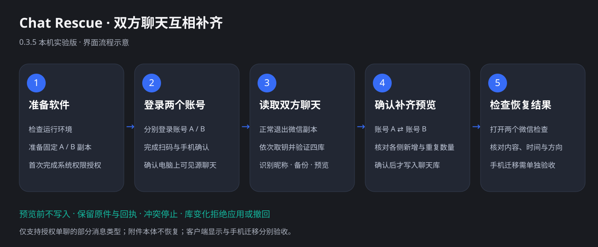

# chat_rescue：微信聊天记录误删恢复工具（macOS）

**这个工具的作用，是帮助你恢复与重要的人的微信聊天记录。**

**chat_rescue 是一款开源的 Mac 微信聊天记录恢复工具**：当你误删了与对方的单聊，而对方仍保留这段记录，可以在双方同意的前提下，从对方保留的聊天记录恢复自己视角下受支持的消息。

项目提供取钥工具、单聊导出、发送/接收视角转换、原库备份、恢复预览和应用脚本，以及完整 SOP 与 Agent 操作指南。希望帮助人们找回与家人、伴侣、朋友等重要的人的对话。首版为 **experimental**，面向 macOS Apple Silicon，同时提供命令行与原生桌面界面。

适用场景：A 是误删方，B 是保留方。B 在自己的 Mac 上导出双方会话，A 核对恢复预览后，把受支持的消息写入自己的本地数据库。需要双方授权、B 仍有源记录，并满足下方版本与消息范围。

**English:** Open-source WeChat chat history recovery for macOS. Restore supported one-to-one messages from the other participant's retained copy, with perspective conversion, backups, preview, and agent-assisted steps. Experimental; both participants must consent. Attachment content and automatic phone synchronization are not supported.

## 最新版：0.3.5 · 本机实验版

桌面版把双方聊天互相补齐收进五步向导：**准备软件 → 登录两个账号 → 读取双方聊天 → 确认补齐预览 → 检查恢复结果**。原有 CLI 保留，支持在不同 Mac 之间通过授权单聊 bundle 完成 B → A 恢复。

[下载与发布说明](https://github.com/Bccccccs/chat_rescue/releases/tag/v0.3.5) · [更新记录](CHANGELOG.md)

### 五步图示

下图依据当前界面与提供的页面截图重绘，使用通用账号标签；是操作示意，不是恢复成功的验收凭证。



| 步骤 | 你需要做什么 | 软件负责什么 |
| --- | --- | --- |
| 1. 准备软件 | 首次退出所有微信，按系统提示授权 | 检查环境，准备固定 A/B 副本；提供软件、Terminal 和两个副本的路径复制与访达定位 |
| 2. 登录两个账号 | 分别登录不同账号，完成扫码与手机确认；确保所需聊天在电脑可见 | 打开两个副本，显示进程状态；运行中不代表身份已验证 |
| 3. 读取双方聊天 | 确认正常退出；首次读取时在终端启动的副本里登录；有歧义时选择已核验昵称 | 依次取钥、验证四个必要数据库、识别本人昵称、读取双方会话、备份并生成预览 |
| 4. 确认补齐预览 | 核对双方昵称、各侧新增和重复数量，再确认补齐 | 确认前不写入聊天库；保留已有消息、跳过重复，冲突或不支持内容停止处理 |
| 5. 检查恢复结果 | 打开两个微信核对时间、内容、头像和收发方向；需要手机记录时自行迁移并验收 | 提供备份与回执入口；数据库验证不能代替实际客户端检查 |

### 当前功能与边界

- 两个固定微信副本使用不同签名标识；A 保留标准应用标识，B 使用独立应用和数据目录。原版微信不被重签。B 首次登录不代表旧记录已经导入。
- 自动发现可确定的账号目录，通过本人昵称核验身份；目录、内部 ID 和密钥路径收在高级设置。
- 双向预览分别显示补齐到 A/B 的新增与去重数量，保留消息编号并转换收发视角。
- 应用前核对双方原库、DB/WAL/SHM 和候选哈希；双向应用是两次协调写入，部分失败会报告已完成侧，不能视作双方全部成功。
- 历史任务可选择含 `sync-plan.json` 的目录续接。只有完整应用且双方库未变化的任务允许撤回；产生新记录时拒绝撤回以保护新消息。
- 账号设置、密钥、备份与任务留在 `~/Library/Application Support/Chat Rescue`。终端可能显示或短暂弹出，用户无需手输命令；登录、手机确认与授权仍由本人操作。
- 当前仅支持单个 `message_0.db` 的授权单聊文本、名片和文件消息条目；不恢复附件本体，不自动同步到微信服务器或手机。

**验证状态：** 本机 61 项合成测试通过，覆盖双向补齐、去重、身份与方向映射、变化拒绝、部分失败回执和撤回保护。截图展示了读取与预览界面；不据此宣称真实双账号数据库应用、微信显示或手机迁移已验收。

### 下载与运行

在 Releases 下载 `Chat-Rescue-0.3.5-macOS-arm64.zip`，解压并打开 `Chat Rescue.app`。仅面向 Apple Silicon；打包目标为 macOS 14+，当前实测环境与微信版本见“开始前”，最低打包版本不等于完整兼容性验证。应用内置 Python 与 SQLCipher，取钥仍需 Apple LLDB / Xcode Command Line Tools。应用使用本地临时签名，尚未完成 Apple 开发者公证。

源码构建（在仓库根目录执行）：

```sh
./desktop/build.sh
```

产物：`dist/Chat Rescue.app` 与 `dist/Chat-Rescue-0.3.5-macOS-arm64.zip`。构建需 Python 3.14、SQLCipher 和 Xcode Command Line Tools。首次使用按准备页完成权限授权；不要使用 sudo 或关闭 SIP。

## 让 agent 帮你运行

**你可以把整个项目交给具备本机文件访问和终端执行能力的 AI agent，让它按教程帮你运行；你主要按照它的提示完成必要的人工作业。** 下载或克隆仓库，在 agent 中打开项目文件夹，然后发送：

```text
请先阅读 AGENTS.md 中的“聊天记录恢复执行提示词”，以及 docs/recovery-sop.md。
我想恢复与重要的人的微信聊天记录，对方仍保留这段记录，双方同意进行恢复。
请按项目流程协助我：你负责环境检查、命令执行、身份映射核对、导出、备份和恢复预览。
每次只告诉我当前需要做的人工作业，例如登录账号、手机确认、授予权限或正常退出微信。
先确认我现在处于保留方 B 导出阶段，还是误删方 A 恢复阶段，并接续已经完成的步骤。
生成具体恢复计划并让我核对后，再按我的确认应用；遇到错误先检查原因并保护原件。
```

agent 的详细执行提示词在 [AGENTS.md](AGENTS.md)：从 B 保存单聊，到 A 翻转视角、生成候选、确认应用和验收，包含命令、检查点与失败处理。你无需自己编写恢复代码。账号登录、手机确认、系统权限授权、双方身份核对和最终结果确认仍由本人完成；取钥若必须在原生 Terminal 运行，agent 会准备完整命令或本地启动文件，你按提示运行即可。

使用 agent 协助运行仍遵循下方的版本与消息范围。私人工作目录留在本机，只把约定的单聊 bundle 交给对方；不要把密钥、整库或大量聊天正文贴进 agent 对话。

## 开始前

- 当前实测环境：微信 4.1.13、macOS 27.0、Apple Silicon。取钥命令只接受 4.1.13；其他版本需先适配并重新验证。
- Python 3.14、Homebrew SQLCipher、Xcode Command Line Tools。
- 需要双方确认真实账号身份，保留原始记录和备份。不要为了恢复再次删除消息。
- 首版只接受单个 `message_0.db` 分片；单聊只支持文本（1）、名片（42）和文件消息（49 的子类型 6）。出现其他分片或会话内其他消息类型时拒绝，不会自动跳过；附件内容不恢复。
- 支持范围与实测结论见 [证据与边界](docs/evidence-and-support.md)。本地数据库修改不能保证手机同步。

## 安装与环境检查

```sh
git clone https://github.com/Bccccccs/chat_rescue.git
cd chat_rescue
xcode-select --install
brew install python@3.14 sqlcipher
python3.14 -m chat_rescue doctor
```

已安装 Xcode Command Line Tools 时无需重复安装。没有 Homebrew 时，先按 [Homebrew 官方说明](https://brew.sh/)安装。命令在仓库根目录执行，无需 `pip install`，不需要 `sudo` 或关闭 SIP。

## 完整流程

请按 [双账号恢复 SOP](docs/recovery-sop.md)执行。先完成 B 的导出，再完成 A 的取钥、预览和应用。

1. B 把手机上仍保留的记录导入 **B 自己的 Mac 微信账号**。
2. B 退出微信，为自己的实际数据库目录取钥，导出明文库，再生成只含 A 会话的 bundle。
3. B 只向 A 分享单聊 bundle，保留密钥和整个数据库在本机。
4. A 在原版微信登录自己的原账号，确认 B 的身份和会话，为自己的实际数据库目录取钥。
5. A 退出微信，生成恢复预览，检查身份、消息方向、去重和冲突结果后运行 `apply`。
6. A 启动原版微信检查。需要手机记录时，手动使用微信的电脑到手机迁移入口，并逐条验收。

## 常见问题

**误删微信聊天记录，还能恢复吗？** 本项目适用于对方仍保留双方记录、愿意提供该单聊的情况。它从对方保留的记录建立恢复方案，需要满足首版的 Mac、微信版本和消息范围要求。

**可以用对方的聊天记录恢复自己的视角吗？** 可以为受支持的单聊转换本地发送者映射与发送/接收方向，生成自己的会话候选，再经备份、预览和确认应用。实际电脑显示和可选手机迁移需分别验收。

**不会写代码可以使用吗？** 可以让具备本机文件和终端权限的 agent 按 [AGENTS.md](AGENTS.md) 协助运行；本人完成登录、权限授权、身份确认和结果验收。

**照片、视频和文件附件也能恢复吗？** 首版不恢复附件内容；支持的文件消息条目不代表附件完整可打开。完整限制见 [支持边界](docs/evidence-and-support.md)。

## 文档

- [双账号恢复 SOP：可复制的命令与操作顺序](docs/recovery-sop.md)
- [命令说明与输出约定](docs/cli.md)
- [隐私、密钥与分享规则](docs/privacy.md)
- [失败处理与回撤原则](docs/troubleshooting.md)
- [实测证据与支持边界](docs/evidence-and-support.md)
- [合成数据测试与运行方法](docs/testing.md)
- [项目介绍、搜索优化与分享建议](docs/sharing.md)

取钥代码采用固定版本的上游 MIT 副本；工具复制并重签专用微信副本，不修改 `/Applications` 中的原版。首次运行副本时需要在系统设置授予相应权限，具体见 SOP。取钥结束不自动重启原版；保持副本固定位置以保留权限，需要时手动打开原版。

## 许可证

本项目自有代码和文档使用 [MIT License](LICENSE)。上游取钥代码的来源、固定提交和版权说明见 [THIRD_PARTY_NOTICES.md](THIRD_PARTY_NOTICES.md)。请勿在 Issue 或 Pull Request 中提交密钥、数据库、聊天正文或个人截图。
