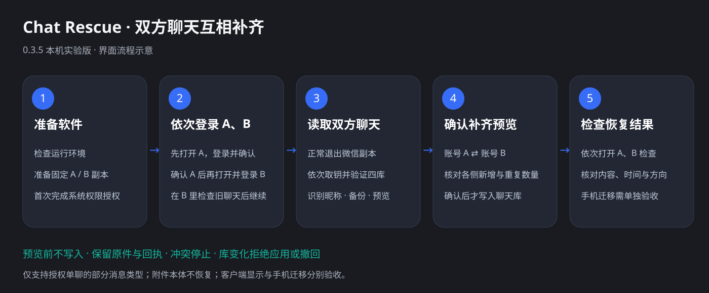

# Chat Rescue 零基础使用教程

本篇适用于 **Mac 桌面版**。Windows 0.3.6 请使用[安装与跨电脑部署说明](windows-deployment.md)和[Windows 五步向导](windows-desktop.md)，其登录顺序为先 A 核验并退出，再 B。

这篇教程对应当前源码构建的 **Chat Rescue 桌面版（顺序登录流程）**，把两个人仍然保留的微信单聊记录互相补齐。你不需要写代码，也不需要自己寻找数据库或密钥文件。主要操作是：安装软件、授权、登录、核对预览、检查结果。

例如：你误删了和朋友的聊天，朋友还保留着。双方同意后，可以尝试用朋友保留的记录补回你的聊天，并转换成你自己的收发视角。

**请先看完“开始前”，确认符合条件，再往下操作。当前是实验版，不能保证每段聊天都能恢复。**

## 开始前：确认这次能不能使用

### 需要准备什么

- 一台 Apple 芯片的 Mac，例如 M1、M2、M3、M4 系列。点击左上角苹果标志 →“关于本机”，查看“芯片”；如果写的是 Intel，本教程不适用。
- Mac 上安装的微信版本为 **4.1.13**。打开微信后，在屏幕顶部“微信”菜单里的关于窗口查看版本；其他版本目前不能按本教程继续，不要为此随意覆盖现有微信或数据。
- 两个微信账号的本人都同意此次操作，并能分别完成登录和手机确认。
- 至少一方仍保留需要恢复的真实聊天，而且能把它放到下面使用的电脑微信窗口里。

桌面包面向 macOS 14 及以上构建，项目记录的实测环境为 macOS 27.0；这不表示所有系统版本都已验证兼容。

本教程使用**同一台 Mac 上的两个微信副本**。如果双方不方便在同一台电脑操作，可以使用[不同电脑之间的恢复流程](recovery-sop.md)，由熟悉操作的人协助。

### 哪些消息可以处理

| 消息 | 当前支持情况 |
| --- | --- |
| 文字 | 支持 |
| 联系人名片 | 支持消息条目 |
| 文件消息 | 支持消息条目，不补回文件本身 |
| 语音、图片、视频及其他类型 | 当前不支持 |
| 群聊 | 不支持 |

**如果这段单聊里混有不支持的消息，软件会拒绝处理整段会话，不会自动跳过它们。** 记录较多、分散到多个消息数据库的账号也可能被拒绝。遇到这类提示就先停下，不要删除聊天、文件或修改消息来绕过检查。

语音恢复目前只有设计方案，本版不能恢复可播放语音。

### 先约定好 A 和 B

为了方便对照，下面一直这样称呼：

| 标记 | 是谁 | 例子 |
| --- | --- | --- |
| A | 误删聊天、希望找回记录的人 | 你 |
| B | 仍保留聊天、愿意提供记录的人 | 你的朋友 |

**桌面版会给双方互相补齐记录，可能同时修改 A、B 两边的本地聊天库。** 它不是只给 A 导入的单向模式。确认时需要分别核对两边的新增数量，并取得双方同意；只想做 B → A 单向恢复时，改用[恢复 SOP](recovery-sop.md)。

不需要先清空任何聊天，也不要为了“方便恢复”再删一次记录。

## 一、下载并打开软件

已发布的 0.3.5 包仍是旧的登录界面；本文的顺序登录流程需使用当前源码构建的应用。

1. 打开[0.3.5 下载页面](https://github.com/Bccccccs/chat_rescue/releases/tag/v0.3.5)。
2. 找到页面下方的 **Assets**，如果列表收起来了，点击展开。
3. 下载 `Chat-Rescue-0.3.5-macOS-arm64.zip`。不要选 `Source code`，那是源码包。
4. 打开 Mac 的“访达”（底部程序栏里的蓝白笑脸图标），进入“下载”。
5. 双击下载的 ZIP 压缩包，解压后找到 `Chat Rescue.app`。
6. 把它拖到访达左侧的“应用程序”，以后从这里打开。

软件尚未完成 Apple 公证。如果提示无法验证开发者，先核对文件来自上面的项目发布页；确认信任后，可按 Apple 的流程操作：尝试打开一次，再进入“系统设置 → 隐私与安全性”，找到对应拦截提示，点“仍要打开”，按系统要求确认。详细步骤见 [Apple 官方说明](https://support.apple.com/zh-cn/102445)。

如果提示包含恶意软件、文件已损坏等内容，保留原提示，先检查来源和文件，不要套用上面的步骤强行放行。

**完成标志：** 看到 Chat Rescue 窗口，左侧有“准备软件”“依次登录 A、B”等五个步骤。



这张图帮助你认位置，是操作示意，不表示你的恢复已经成功。

## 二、第一次使用：准备软件和权限

### 1. 先正常退出所有微信

分别切换到每一个微信窗口，按 **⌘Q**。如果弹出退出确认框，完成确认。

⌘ 是键盘上的 Command 键。点窗口左上角的红色圆点通常只是关窗口，不等于退出微信。

### 2. 如果缺少 Apple 命令行工具，先安装

桌面版已经带有 Python 和 SQLCipher，不需要另外安装这些组件。它还需要 Apple 的“命令行工具”，用于读取本机微信加密资料。

如果环境检查提示缺少该工具：

1. 按 **⌘空格** 打开搜索。
2. 输入“终端”，按回车，打开 Terminal。
3. 复制下面这一行，粘贴进去，按回车：

   ```sh
   xcode-select --install
   ```

4. 如果出现安装窗口，按提示安装并等待完成。
5. 如果提示已安装，不用重复安装。回到 Chat Rescue 查看环境状态；状态没有更新时，退出并重新打开 Chat Rescue。

这是 Apple 提供的安装方式，见 [Apple 命令行工具安装说明](https://developer.apple.com/documentation/xcode/installing-the-command-line-tools/)。安装失败时保留提示，先解决环境问题。

### 3. 准备两个固定的微信副本

在“准备软件”页点击 **“自动检查并准备”**，等待显示 **“两个微信副本已准备”**。

这里的“副本”可以理解成专门用于本次操作的两个微信应用，分别标记为 A、B。软件不会给“应用程序”里的原版微信重新签名；但后续确认补齐会修改对应账号的聊天资料。

**B 副本使用独立的数据目录。** 即使朋友以前在这台 Mac 的原版微信登录过，B 副本里也不一定有那些旧聊天。

### 4. 给四个应用开启完全磁盘访问权限

这个权限让软件可以读取受保护的微信资料，需要你本人操作：

1. 在准备页点击 **“打开权限设置”**。
2. 进入“隐私与安全性 → 完全磁盘访问权限”。
3. 找到列表下方的 **“＋”**，系统要求验证时用 Touch ID 或 Mac 登录密码确认。
4. 回到 Chat Rescue，找到第一项 **Chat Rescue**，点击旁边的 **“复制路径”**。
5. 切回系统设置的添加窗口，按 **⌘⇧G**，打开“前往文件夹”。这里 ⇧ 是 Shift 键，三个键同时按。
6. 按 **⌘V** 粘贴路径，按回车，再点“打开”或添加按钮。
7. 确认新加入项目旁边的开关已打开。
8. 对下表另外三项重复操作。

| 要添加的应用 | 路径从哪里拿 |
| --- | --- |
| Chat Rescue | 准备页对应的“复制路径” |
| Terminal（终端） | 准备页对应的“复制路径” |
| 微信 A 副本 | 准备页对应的“复制路径” |
| 微信 B 副本 | 准备页对应的“复制路径” |

两个副本可能都显示微信图标，请根据各自复制的路径添加，不要只加原版微信。授权后保持副本的位置不变。

系统要求退出并重新打开某个应用时，按提示完成。后续如果出现“开发者工具”授权，请允许本次操作使用的 Terminal；没有出现就不需要找额外的开关。

**完成标志：** 两个副本已准备，四个应用已加入权限列表并开启开关，可以进入“依次登录 A、B”。

## 三、分别登录，并确认旧聊天真的在电脑里

1. 进入左侧 **“依次登录 A、B”**。软件只自动打开 A；如未打开，点击 **“打开微信 A”**。
2. 在 A 窗口登录误删记录的账号，用本人手机扫码、确认，核对头像、昵称和 B 的联系人。A 不必已有误删的旧消息。
3. 回到软件勾选 A 的确认项，点击 **“A 已确认，下一步打开 B”**。这时才会打开 B。
4. 在 B 窗口登录保留记录的另一位参与者的账号，由本人完成手机确认，核对与 A 是不同的人。
5. 在 B 窗口检查所需旧聊天，按下面的方法确认；完成后回到软件勾选 B 的两项检查。
6. 点击 **“B 已检查，下一步读取聊天”**。没完成当前步骤时不能跳到读取。账号选错可点击 **“账号选错了？返回 A 重新检查”**。

### 这一步最容易漏：在 B 窗口找到那段旧聊天

在 **B 副本窗口** 打开朋友和你的会话，向前翻，找到你希望恢复的日期和几条具体消息。

如果 B 窗口里没有记录，但朋友手机里有，就先用微信自己的聊天迁移功能，把手机记录导入这个电脑账号。入口文字以当前微信界面为准；操作时核对来源是朋友的手机，接收方是朋友登录的电脑账号，并关注两个副本中实际接收的是哪一个。

**迁移或登录完成后，一定回到 B 副本窗口再查一次。只在手机里看到，或者只在原版微信里看到，都不能代替这里的检查。** 登录不会自动把全部历史聊天下载下来，官方备份包也不能直接作为本工具的聊天来源。

A 端不必先出现误删的旧消息，但应确认朋友的联系人身份正确。A 原有的聊天也要保留。

窗口上“运行中”仅说明微信进程打开了；软件要在下一步读取后才能核验账号身份。

**完成标志：** A、B 登录正确，B 副本里能翻到需要恢复的旧记录。然后勾选 B 的两项检查，点击 **“B 已检查，下一步读取聊天”**。

## 四、读取双方聊天并生成预览

1. 在 **“读取双方聊天”** 页，点击 **“开始读取并生成预览”**。
2. 软件会请求两个微信副本正常退出。如果微信弹出确认框，请确认退出；如果原版仍开着，也要正常退出。
3. 接下来软件会依次处理 A、B，可能弹出终端并再次启动微信。
4. 看清软件正在处理哪一侧，在当前启动的微信里登录该侧账号，并完成手机确认。**处理 A 时登录 A，处理 B 时登录 B。**
5. 如果出现权限提示，按上一步的方法授权；终端窗口先保留，不要手动关闭正在运行的任务。
6. 等待软件核验、识别昵称并继续。如果出现“请选择你刚刚登录的账号”，选择本人核对过的昵称；同名或无法分辨时先停下。

“取钥”是软件在本机取得读取该账号加密聊天所需信息的过程。你不需要复制密钥，也不需要把它发给任何人。两侧依次进行，需要根据提示分别完成登录。

软件会读取聊天、保存备份，并生成补齐预览。这一步不会把恢复消息写入原聊天库。等待期间不要另开原版微信或切换账号。

**完成标志：** 软件进入“确认补齐预览”，显示双方真实昵称，以及各侧的新增、重复数量。

如果出现红色或橙色报错，展开 **“查看错误详情”**，按后面的故障表处理；出现一个昵称或一个文件，不表示整步已完成。

## 五、核对预览，再确认补齐

### 先看清楚两个名字

页面里的两个昵称必须对应你和朋友。如显示陌生账号、同名无法确认，先不要点击补齐。

### 再分别看两行数量

下面是假设的示例，实际数字以你自己的界面为准：

| 预览 | 表示什么 |
| --- | --- |
| 补齐到你：新增 100 条，已有重复 20 条 | 准备向你的本地聊天加入 100 条，另外 20 条判定已有，跳过 |
| 补齐到朋友：新增 3 条，已有重复 20 条 | 朋友一侧也会加入 3 条，另外 20 条跳过 |

新增条数不是成功验收条数。“新增 0 条”也不一定是故障，可能已存在相关消息；但如果你明明缺很多记录，应先回到上一阶段核对 B 副本是否真的有那些记录、账号是否正确。

桌面预览主要显示身份和数量，**不会逐条展示全部聊天正文**。需要在写入前核对具体消息时，先点 **“查看备份与回执”** 保留任务位置，再请本机助手按 [恢复 SOP](recovery-sop.md) 中的只读方法核对候选记录。核对完成前不要应用。

### 确认前检查四件事

- 双方身份正确，也都同意这次双向补齐。
- 两边新增数量符合预期。
- 已通过 **“查看备份与回执”** 找到并记下本次任务目录。
- 没有未解决的报错，两个微信保持退出。

确认后，点击 **“昵称与数量正确，确认补齐”**。弹出“确认补齐双方聊天？”时，再核对一次，点击 **“已核对昵称与数量，开始补齐”**。

接下来等待完成，不要重新打开微信、退出工具或移动任务目录。

**完成标志：** 页面显示 **“数据库补齐已完成”**。它表示本地数据库应用完成，接下来还要检查微信实际显示。

如果出现“部分完成”“中断”或写入失败，先保持微信退出，保存任务目录和错误信息，请熟悉项目的人核查各侧回执。双向处理可能一边完成、另一边失败，不能直接重复点击补齐。

## 六、打开微信，检查恢复结果

依次点击 **“打开微信 A 检查”**、**“打开微信 B 检查”**，分别找到双方会话。

建议先检查一条你发出的、一条朋友发出的旧消息，再检查最早、最晚需要恢复的日期，并根据实际条数继续核对：

| 检查项 | 怎么判断 |
| --- | --- |
| 聊天对象 | 联系人、昵称和头像对应正确的人 |
| 收发方向 | 你当年发的仍显示为你发出，朋友当年发的仍显示为对方发来 |
| 内容和时间 | 文字、卡片信息、日期和时间符合原记录 |
| 原有消息 | 补齐前已有的记录仍然存在 |
| 文件条目 | 可以核对消息条目，但不能据此认定附件已恢复或能打开 |

方向、内容或原记录出现异常时，正常退出微信，停止手机迁移，保留本次备份和回执再排查。

**完成标志：** 双方分别确认电脑里的内容、时间、方向和已有记录正确。只有软件提示完成，还不能替代这次人工检查。

## 七、如果还希望手机里也有记录

电脑验收正确后，再由本人使用微信提供的**电脑到手机聊天迁移或导出入口**操作。界面名称以当前版本为准，选择前确认传递方向是电脑 → 手机，选中这次核对过的会话和记录范围。

如果界面显示的是旧备份列表，不要直接把某个旧备份当作本次补齐后的聊天。先确认你选择的资料包含当前电脑记录。

完成后在手机里重新检查联系人、收发方向、时间、内容和原有消息。

Chat Rescue 不会把结果自动同步到微信服务器或手机。**电脑有、手机没有时，应记为“电脑已确认，手机未通过验收”**，先保留资料排查，不要连续重复恢复或迁移。

## 八、操作后保留哪些东西

本机资料通常保存在：

```text
~/Library/Application Support/Chat Rescue
```

这里的 `~` 表示你当前 Mac 用户的个人文件夹。不需要手动输入这个路径，优先使用软件里的 **“查看备份”** 或 **“查看备份与回执”**。

验收前保留整个本次任务目录，里面的原件、计划和回执用于核查或处理异常。不要随意删除、改名或移动已经授权的微信副本。

密钥、聊天数据库和备份都是私人资料，不要上传公开网盘、公开问题单或直接贴进 AI 对话。需要求助时，先提供工具版本、停在哪一步、已遮住个人信息的错误文字。

如果中途关闭了工具，可以通过顶部 **“历史任务”** 选择包含 `sync-plan.json` 的本次任务目录接续。中断或部分完成的任务，需要先检查回执，再决定下一步。

## 九、常见卡点怎么处理

| 你遇到的情况 | 接下来怎么做 |
| --- | --- |
| “自动检查并准备”按钮点不了 | 看窗口顶部环境状态，先处理缺失的 Apple 命令行工具等提示；不要反复点击 |
| 找不到原版微信 | 在访达“应用程序”确认原版位置，再到软件“高级设置”的“原版微信”点“选择”；不要选 A/B 副本 |
| 微信窗口关了，软件还说没退出 | 切换到微信，按 ⌘Q，处理退出确认框；检查原版和两个副本 |
| 微信启动后立即退出 | 展开“查看错误详情”，保留退出码与日志位置；这不一定是“没有退出”的问题 |
| 提示权限不足、读取失败 | 核对四项完全磁盘权限、Terminal 的开发者工具授权和当前登录账号；解决原因后再重试读取 |
| B 登录了，但聊天是空的 | 先将保留的记录迁入 B 副本，并在 B 窗口实际找到旧消息 |
| 两个窗口对应同一个账号 | 在其中一个窗口切换为另一位参与者的账号，再重新读取 |
| 昵称或账号目录无法确定 | 不要随便选第一项；先核对身份，必要时请本机助手协助 |
| 提示不支持消息类型或多个消息库 | 当前版本不能继续；不要删消息、删分片或改类型绕过 |
| 预览之后提示原库发生变化 | 正常退出微信，重新读取并生成新计划，再核对新预览；不要修改旧报告 |
| 写入失败、部分完成或中断 | 保持微信退出，保留备份和回执；先检查哪些侧已经完成，不重复应用旧计划 |
| 电脑显示正确，手机不对 | 停止重复迁移，分别记录电脑和手机结果，保留任务材料后排查 |
| 想撤回 | 完整补齐后的结果页有“撤回本次补齐”；只在双方数据库未变化等检查通过时允许，出现新消息会被拒绝，不能强行拿旧备份覆盖 |

更详细的处理方式见[失败处理与回撤原则](troubleshooting.md)。

## 十、需要助手陪你一步一步操作时

可以把项目文件夹交给具备本机文件与终端权限的 AI 助手，然后复制这段话：

```text
我是完全的新手，想使用 Chat Rescue 恢复双方授权的微信单聊。
请先阅读项目 AGENTS.md、docs/beginner-guide.md 和相关恢复文档。
先检查我是否符合微信版本、电脑和消息类型的要求。
每次只让我完成一个当前需要的人工作业，告诉我在哪个窗口、点哪个按钮，
以及看到什么才算完成；能由你在本机检查的部分请直接检查。
我说“好了”时，请先核对当前步骤的实际状态，再继续。
写入前先生成具体预览，说明会修改哪一侧、各新增多少条、备份在哪里，
等我核对并确认这份计划后再应用。
不要替我登录、索取密码，或把密钥和聊天正文发到对话里。
```

账号登录、手机确认、系统授权、双方身份确认和最终聊天检查，都需要本人完成。
