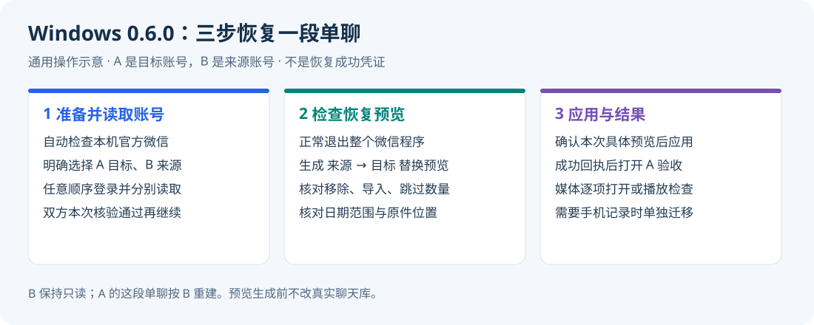
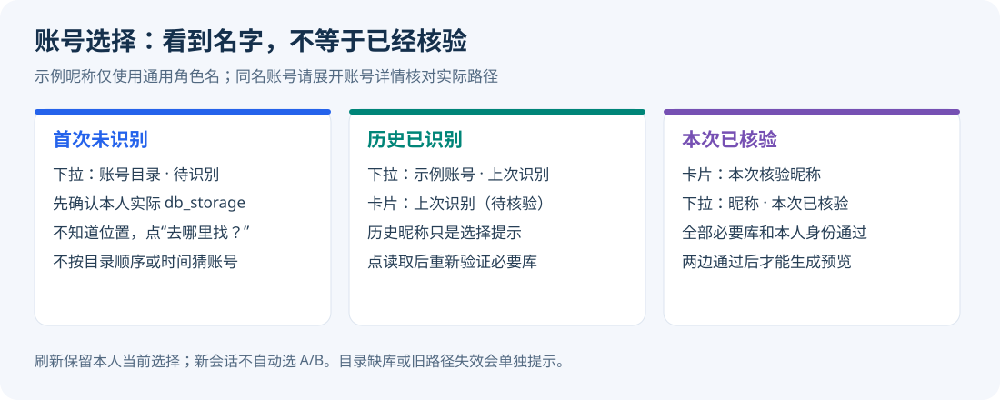
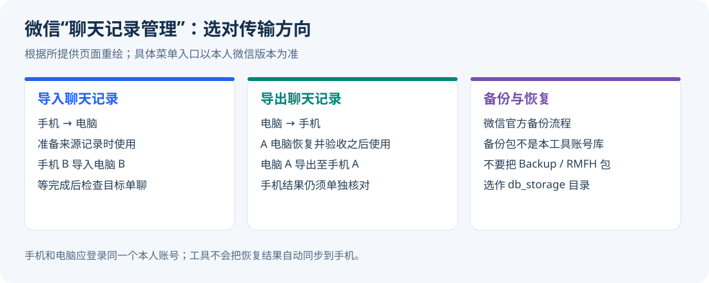

# Windows 零基础操作教程

本文对应 **Windows 0.6.0 实验预发布版**。旧版 0.5.6 的五步说明仅供历史参考；新版已把重复的登录、读取页面合并为三步。[下载 0.6.0](https://github.com/Bccccccs/chat_rescue/releases/tag/v0.6.0) · [本轮工作总结和限制](releases/v0.6.0.md)。

目标账号（内部 A）是要恢复到的账号；来源账号（内部 B）提供保留的聊天。本工具用来源重建目标中的这一段单聊：目标原有的本段会话可能被移除，其他会话保留，来源只读。必须由双方授权并核对具体预览。

## 完整解压后打开

整合包包含运行时、SQLCipher、恢复程序和离线文档，**不附带微信，也不要求卸载或重装微信**。使用本机腾讯官方微信，工具检查版本、架构和签名。完整解压后运行 `ChatRescue.exe`，不要只移动 EXE。[下载便携 ZIP](https://github.com/Bccccccs/chat_rescue/releases/download/v0.6.0/Chat-Rescue-0.6.0-Windows-x64-Portable.zip) 后先点“全部解压”，再打开程序；也可使用同页 Setup 安装包。需要 Windows 10（19041+）或 Windows 11 x64，以及系统 .NET Framework 4.8+。

## 先弄清楚：谁提供记录，恢复到谁

例如，A 误删了和 B 的聊天，B 还保留着：**左边选 A（目标），右边选 B（来源）**。下面所有图都是通用重绘示意，不含真实账号；灰色按钮表示条件未完成，不代表恢复成功。



## 第一步：准备并读取账号

1. 点击“自动检查并准备”，找不到微信时手动选择本机 `Weixin.exe`。准备完成后软件检查区收起为摘要。
2. 在下拉列表中明确选择目标和来源。曾识别过的账号显示“昵称 · 上次识别”；同昵称会附路径，可悬停或展开“账号详情”核对。历史昵称只是提示，不代表本次通过；角色可任意顺序读取，新会话即使只有一个目录也不自动替你选。首次没有昵称时见下方“手动找账号目录”。
3. 点击“打开微信并登录账号”，本人扫码或手机确认。登录后回到工具，刷新目录，点击“读取目标账号”或“读取来源账号”。**登录和数据库读取是两个状态**，验证全部必要库与本人身份后才显示本次已核验昵称，下拉框同步显示。
4. 来源所需聊天应在电脑微信完整可见；仅在手机上时，由本人先通过微信导入电脑，确认内容和日期范围，再勾选来源完整性确认并读取。
5. 换账号前从微信菜单正常退出整个程序。已有密钥与配套 `keys.capture.json` 时，可保持微信退出并读取验证。历史昵称只作提示，不代表当前核验成功。普通目录选择也会查找当前工作区内同一内部身份和目录的已验证密钥，无需先载入上次角色；只复用材料，每次仍重新核验。若微信仍在运行且已有匹配密钥，按提示正常退出后读取即可。



### 记录只在手机上，先导入电脑

在 **B 自己的电脑微信** 打开“聊天记录管理”，选 **“导入聊天记录”**，按微信提示将 **手机 B → 电脑 B** 的记录复制过来。等进度完成，打开与 A 的单聊，核对日期、内容和所需媒体。已经完整存在就不用重复导入。菜单入口随微信版本不同，以本人界面为准。



“备份与恢复”生成的官方备份包不是本工具所需的账号数据库。不要把 Backup/RMFH 包选成账号目录，也不要把 B 的手机记录直接导入 A 的账号。

### 需要语音、图片、视频时再开媒体选项

如需恢复语音或图片/视频/文件本体，明确开启媒体实验选项，默认关闭。语音选项改变后双方须重新核验，顺序不限。附件消息状态未适配、缺媒体库、缺本地文件、DAT 解密或目标重加密证据不足时跳过本体、保留消息并计数；已有库密钥/完整性失败和身份冲突仍停止。[媒体范围](windows-media.md)。

### 手动找账号目录：去哪里找

每张账号卡片都有 **“去哪里找？”** 按钮，可直接打开同样的查找提示。

1. 在本人已登录的电脑微信中打开设置，查看实际的文件/数据保存位置；按钮名称随版本可能不同，以本人界面显示为准。有打开文件夹入口时可使用它。
2. 查常见位置时，按 `Win + E` 打开资源管理器，在地址栏输入 `shell:Personal` 并回车，进入当前Windows用户的“文档”，再找 `xwechat_files`。这比手写用户名更能适应文档重定向；自定义存储目录以微信设置显示的位置为准。
3. 进入本人已确认的账号目录，选择其中的 **`db_storage`**。常见路径示例：

   ```text
   C:\Users\你的Windows用户名\Documents\xwechat_files\某账号目录\db_storage
   ```

4. `db_storage` 下应有 `message`、`session`、`contact` 文件夹；必要库包括 `message/message_0.db`、`message/message_resource.db`、`session/session.db`、`contact/contact.db`，以及实际已有的其他消息分片。不要选择微信安装目录、官方备份包或包含多个账号的 `xwechat_files` 总目录。
5. 若选到了 `db_storage/message`，工具会明确提示返回父级；若选的是单个账号目录且下面直接存在 `db_storage`，也会提示进入这一层。规范化后仍检查缺库，并列出具体文件；不会自动忽略缺库。

**如果微信设置只显示基础位置，而你无法确认多个子目录分别属于谁，当前没有可靠的首次自动对应能力。** 不按目录编号、修改时间、昵称相似度或对外微信号猜测，也不轮流取钥试账号。已有工作区的历史昵称提示可帮助核对；最终仍需要本人身份确认和数据库验证。[识别证据与限制](windows-account-discovery.md)。

目录卡片会区分“首次未识别”“历史已识别、待本次核验”“本次已核验”“目录缺库/路径失效”。刷新保留当前选择；缺库或失效时按提示重新定位，不会自动选另一个同名目录。

## 第二步：检查恢复预览

两侧核验通过、来源完整性确认后进入第二步。这里不重复选账号、读取账号；正常退出微信后点击“生成来源 → 目标替换预览”，软件统一检查数据库、身份、方向、分片和媒体，保存 DB/WAL/SHM 原件后生成候选。

核对双方昵称、目标将移除数量、来源导入数量、暂不导入条目、日期范围、媒体成功和跳过原因，以及原件位置。来源没有的本段消息不会自动与目标合并保留。预览不会直接改真实库。

## 第三步：应用与结果

第二步检查后点“预览已核对，下一步确认应用”，第三步核对摘要并确认具体预览后才应用。回执成功后由目标本人在微信检查联系人、方向、时间、正文及已有消息。启用媒体时分别打开图片/文件、播放语音/视频；数据库通过不代表媒体播放成功。手机迁移单独操作和验收，不会自动同步。

### 要把结果放回手机

先由 **A 在电脑微信** 验收本段单聊；确认后，在 A 的“聊天记录管理”中选 **“导出聊天记录”**，按微信提示将 **电脑 A → 手机 A** 的记录复制过去。迁移后在手机再次核对内容、收发方向、日期和媒体。电脑恢复不会自动同步手机。

应用失败或提示中断时保留任务，不能重复应用；已有原件和回执通过“历史任务”查看。验收前不删除原件。

## 换电脑继续任务

1. 在旧电脑点“导出接续任务”，选择保存位置。工具会创建唯一新目录，只收纳当前任务关联资料，不复制整个工作区或真实微信目录。
2. 接续目录可能包含双方密钥、聊天和整库原件，**仅供同一授权操作者换机**，请通过私密方式保管和复制；不要交给无关人员。跨参与者交付仍只使用项目原有的授权单聊 bundle。
3. 在新电脑完整解压程序，点“载入接续任务”，选择含 `transfer.json` 的目录。工具检查清单与哈希，并复制进当前用户的私有工作区。
4. 在新电脑准备可访问的双方微信数据库，重新选目录、核验全部必要库和身份，再生成新预览。相同内部账号更换目录可保留旧密钥引用，是否可用由验证决定。接续目录不代替微信官方数据迁移。
5. 旧预览、原件与应用/中断回执保持历史状态，只供查看；不能在新电脑直接应用或撤回。已有应用或中断历史时，须保留旧任务并显式“新建恢复任务”。

支持只读完一侧、双方已读但尚未预览，以及失败任务的进度保存。重开同一电脑通过“继续本机任务”选择 `tasks/<任务标识>/task.json`；不会自动套用上次角色或身份确认。

## 遇到问题先看这里

| 情况 | 处理 |
| --- | --- |
| 顶部已显示昵称，但目录标签仍写“读取后识别” | 旧版界面标签未同步；整合版已统一更新，无需重新取钥来改标签 |
| 登录后没有昵称 | 点击读取；登录本身不会读取数据库。失败时查看卡片的具体阶段与已验证 X/Y 库覆盖 |
| 目录不明确或多于一个 | 刷新并核对账号详情，必要时手选实际 db_storage；不要轮流盲试 |
| 按钮是灰色 | 先完成环境检查、明确选目录和双方授权确认；来源还需勾选聊天完整性确认。第二步生成预览须双方本次核验通过；第三步须核对具体预览 |
| HMAC 未覆盖全部库 | 保留失败诊断和任务，核对目录、所选本机微信版本与登录状态；没有保存有效的部分密钥，不能生成应用计划 |
| 历史昵称标“待重新核验” | 需要重新读取，不能当作当前身份成功 |
| 语音开启后 HMAC 变成 0/N | 这是账号密钥或所选目录验证失败，不能按“缺媒体”跳过。核对当前登录账号与目录，保留私有诊断；已存在的媒体库仍须验证 |
| Windows 语音库存在未适配表 | 未知语音结构还不能安全转换，保留诊断；不要删表、改库或伪造回执。附件状态跳过规则不适用于此项 |
| 发现 media_N.db-first.material / -incremental.material / -last.material | WCDB 元数据备份，整合版保留、不解密且不误报为未知 sidecar；不要删除 |
| 附件消息状态未适配 | 新整合版保留消息和原状态、跳过对应本体，预览显示状态与数量；旧媒体预览重新生成 |
| 格式不支持或媒体条件缺失 | 对应本体跳过，保留消息；在预览查看分类数量与原因 |
| 只有开始回执、应用失败或中断 | 保持微信退出并保留整套原件，按 [失败处理](troubleshooting.md) 核查，禁止重复应用 |

## 程序、聊天和任务分别存在哪里

- **程序**：你解压 ZIP 或安装程序的位置。复制程序不等于复制聊天和任务。
- **微信聊天原库**：你在卡片选中的实际 `db_storage` 目录，仍由本机微信管理。
- **密钥、任务、候选、原件与回执**：工具的私有工作区；点左侧“打开私有工作区”直接查看。原件的具体路径以本次预览为准。不要手动混搭不同任务的 DB/WAL/SHM。
- **换机接续**：用“导出接续任务”，不要只把程序 ZIP 搬过去就以为任务也迁移了。

私有工作区默认 `%LOCALAPPDATA%\ChatRescue\Desktop`，也可点击“打开私有工作区”；路径以界面为准。不要公开密钥、数据库、聊天或整个接续目录。普通模式共享当前 Windows 用户配置，微信可能记住历史账号，需本人切换和核对；不承诺宿主登录缓存隔离。

[返回项目首页](../README.md) · [安装与跨电脑部署](windows-deployment.md) · [支持边界](evidence-and-support.md)
